<p align="center">
  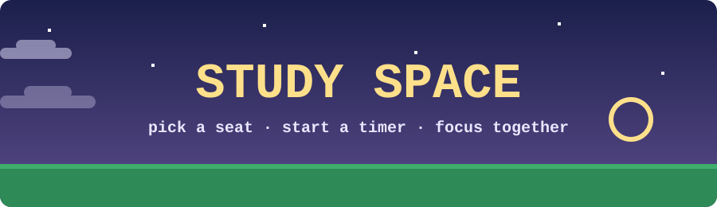
</p>

<p align="center">
  
  
  
  
</p>

A cozy pixel-art world for studying together. Grab a seat, start a focus timer
that floats above your avatar, and earn coins for every minute you finish.
Bring a friend to a Library Buddy Desk, or take a break at the café.

## Highlights

|  |  |
| --- | --- |
| 🗺️ **Nine maps** | Town, library, café, garden, riverside, sky island, glass dome and more |
| ⏱️ **Focus timer** | Server-owned sessions, streaks, 14-day stats and coins |
| 🏠 **Homes & shop** | Decorate a private room with furniture you earn |
| 🎙️ **Voice & video** | Peer-to-peer WebRTC calls with everyone in your room |
| 🌤️ **Living world** | Shared day/night clock, weather, synthesised ambience and lo-fi |
| 👥 **Multiplayer** | Four named servers, invite codes, friends, mute/block/report |

## Focus timer: the heart of Study Space

<p align="center"></p>

Sit at any desk, bench or café table and press **Start timer**. A countdown
floats above your avatar, so everyone in the room can see you are focusing.

- **Server-owned:** the server runs your session, so it cannot be faked or
  lost if you refresh.
- **Coins:** 1 coin for every whole minute studied. Standing up early keeps the
  minutes you finished. Spend coins on furniture, wallpapers and floors.
- **Streaks and stats:** a day counts once it holds 10 focus minutes. The stats
  page shows today, streaks, a 14-day chart, subjects and recent sessions.
- **Focus mode:** chat is switched off while the timer runs, music dips, and
  walking away never ends the session by accident.
- **Focus ghost:** at a Library buddy desk, an optional private ghost of your
  last session keeps the paired seat warm.

## Study with friends

Study Space is built so you never study alone unless you want to.

1. **Same servers, same rooms.** Pick a named server (Maple, Birch, Cedar or
   Willow). Each instance holds 50 players and a new one opens when it fills.
2. **Invite code.** Click the connection chip, share the short code, and your
   friend lands in the same instance as you.
3. **Friends list.** Add people from the **Friends** button, see who is online
   and visit them, including at their private home room.
4. **Buddy Desks.** Sit in paired seats at the Library, see each other's focus
   or break status, and press **Sync with Buddy** to share one focus and break
   schedule. Accepted friends also share a private buddy tree that grows while
   you both focus in the same room instance.
5. **Talk if you like.** Nearby chat, emotes, and peer-to-peer voice and video
   calls with everyone in your room. Mute, block and report are always one
   click away, and silent zones keep the library quiet.

## Explore the campus

Every map is a place with its own mood, ambience and purpose. Walk between them
through doors, gates and portals.

| | |
| --- | --- |
| 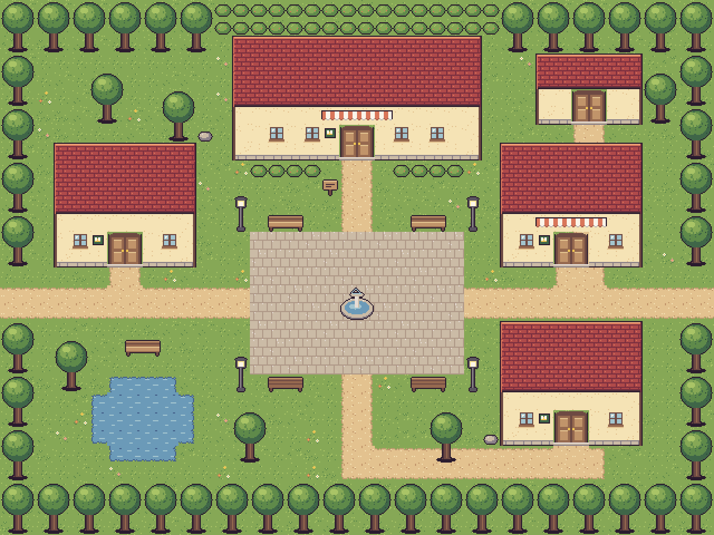<br>**Town Square.** The hub: doors to everything. | 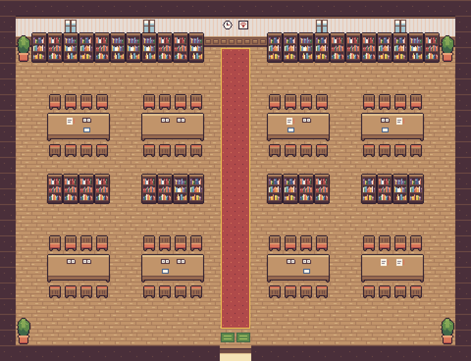<br>**Library.** Silent desks in four subject corners and Buddy Desks. |
| 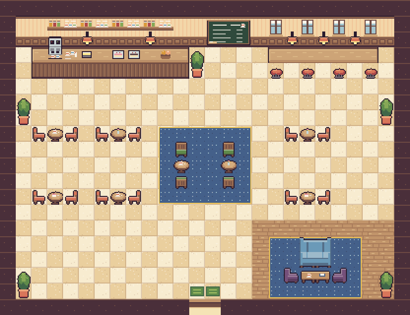<br>**Café.** Chat allowed. Order a drink and study over tables. | 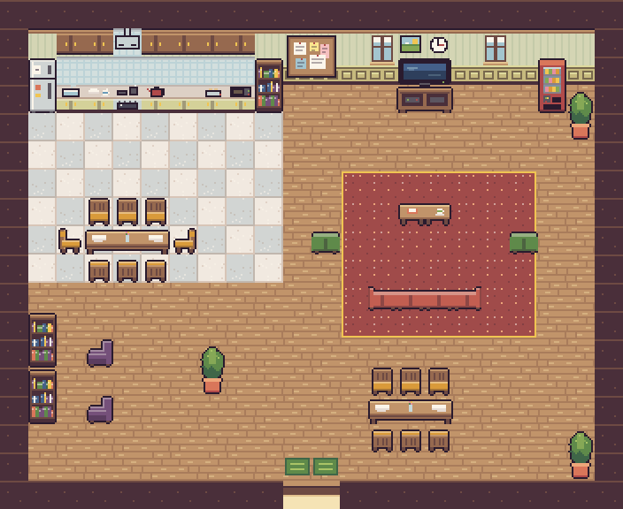<br>**Common Room.** Kitchen, sofa and TV for breaks. |
| 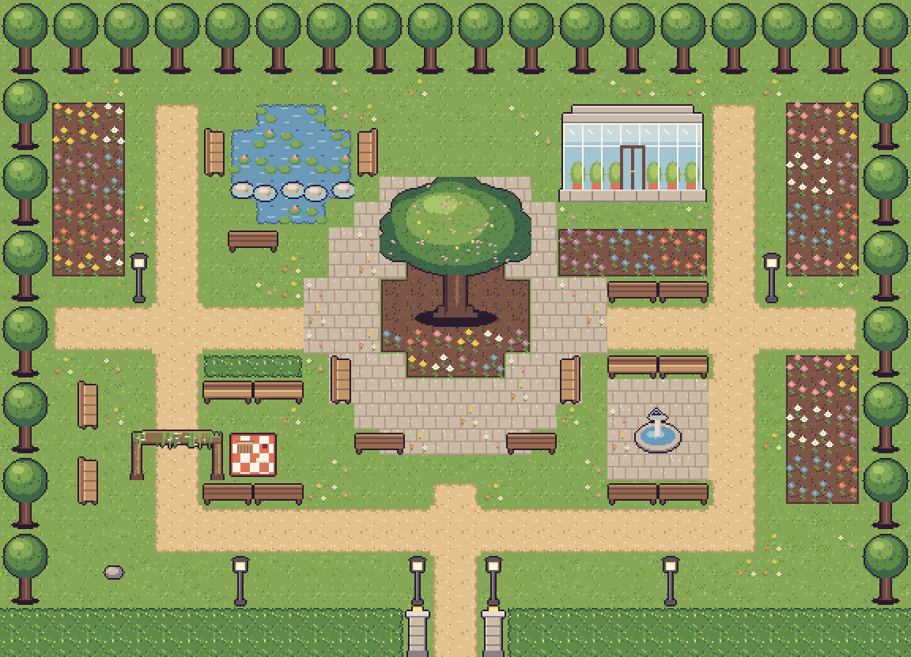<br>**Garden.** Study benches and the shared tree. | 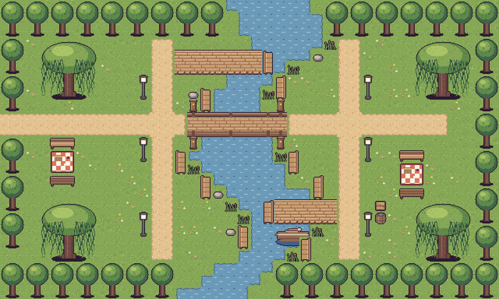<br>**Riverside.** Bridge, pier and benches by the water. |
| 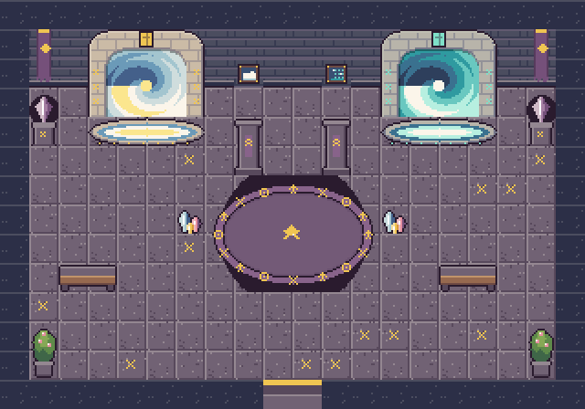<br>**Portal Room.** Two portals to other worlds. | 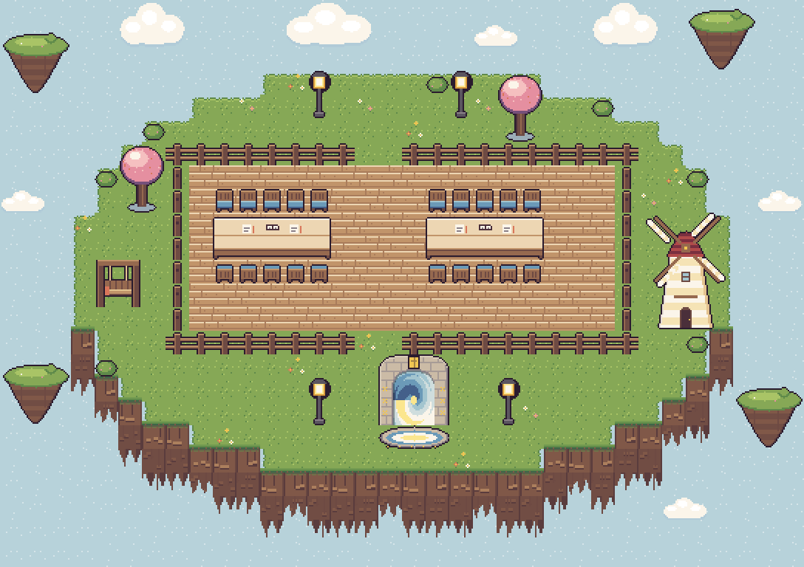<br>**Sky Island.** A floating study deck above the clouds. |
| 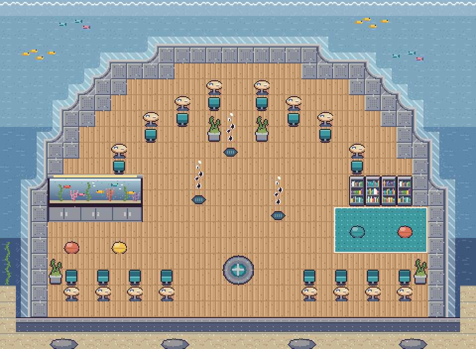<br>**Glass Dome.** Underwater study pods. | 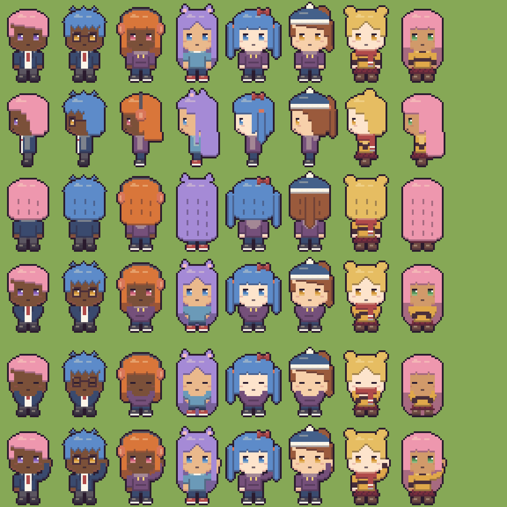<br>**Your look.** Customise skin, hair, outfit and pets. |

## Quick start

Requires Node.js 20+.

```bash
docker compose up -d db                 # Postgres 16 (skip for guest-only play)
cp server/.env.example server/.env
npm install
npm run db:migrate -w server            # once
npm run dev:all                         # server :2567, client :5173
```

Open http://localhost:5173 in two tabs to see two players. Without a database
guests play normally and accounts are switched off. Choose **Play solo
(offline)** to run without the server.

## Useful commands

| Command | What it does |
| --- | --- |
| `npm run assets` | Regenerate sprites, tilesets, maps and `assets.json` |
| `npm run check -w tools` | Verify every door, spawn and seat on all maps |
| `npm run test -w server` | Server tests (accounts need Postgres) |
| `npm run typecheck` | Type-check every package |
| `npm run build` | Production build into `client/dist/` |

## Docs

- [Guide](docs/GUIDE.md): controls, sound, voice/video, accounts, multiplayer rules, deployment
- [Phase 6 features](docs/PHASE6.md) · [Accounts](docs/ACCOUNTS.md) · [Homes](docs/HOMES.md) · [Assets](docs/ASSETS.md)
- Hosting guide: `deploy/oracle/README.md`

## Layout

```
shared/   protocol, timer and pathfinding shared by client and server
server/   Colyseus game server: rooms, validation, timers, chat, REST API
tools/    asset generator: characters, pets, tiles, maps
client/   Phaser 3 + Vite game and HTML interface
docs/     guides and the README banner
```
